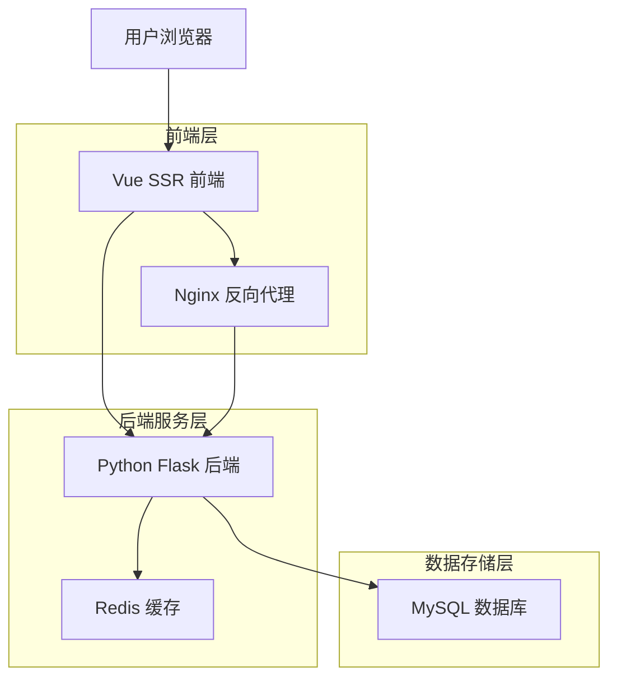
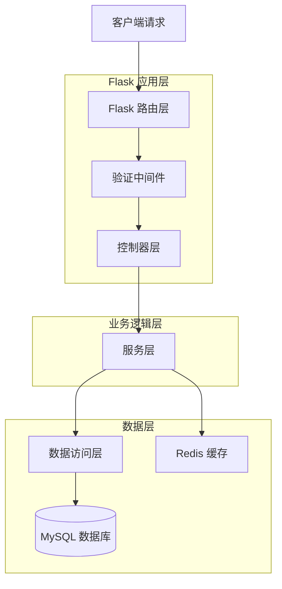
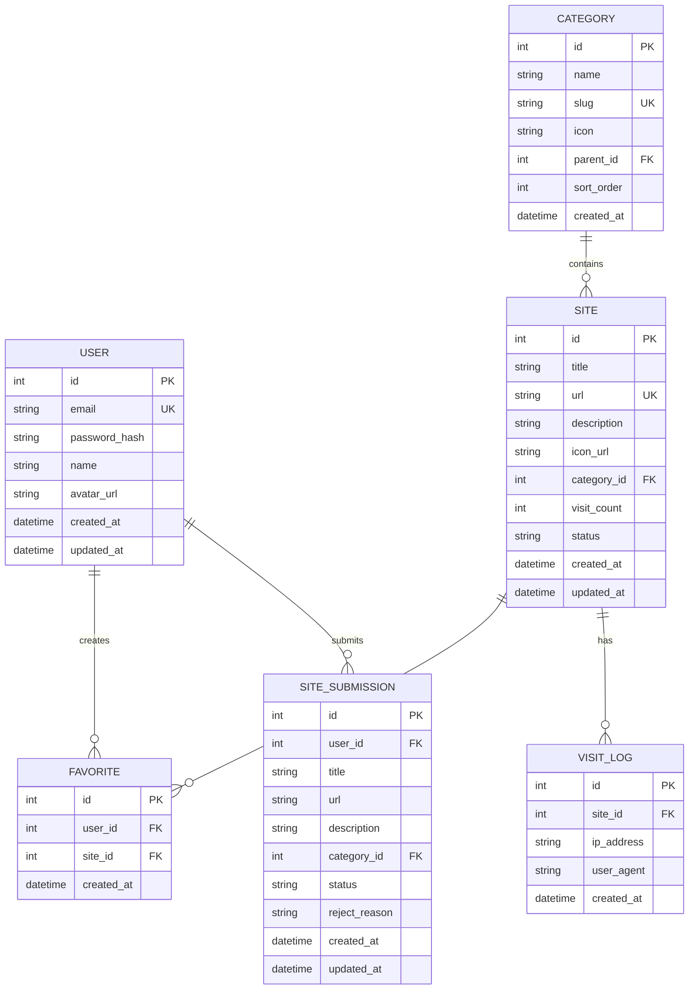

## 1. 架构设计



## 2. 技术描述

- **前端**: Vue@3 + Nuxt@3 (SSR) + TailwindCSS@3 + TypeScript
- **初始化工具**: nuxt-init
- **后端**: Python Flask@2 + SQLAlchemy@2 + Marshmallow@3
- **数据库**: MySQL@8 + Redis@7 (缓存)
- **部署**: Docker + Docker Compose + Nginx

## 3. 路由定义

| 路由 | 用途 |
|-------|--------|
| / | 首页，展示导航分类和热门网站 |
| /category/:slug | 分类页面，展示特定分类下的网站 |
| /search | 搜索页面，展示搜索结果 |
| /site/:id | 网站详情页面，展示网站详细信息 |
| /user/login | 用户登录页面 |
| /user/register | 用户注册页面 |
| /user/dashboard | 用户中心，管理收藏和常用网站 |
| /user/submit | 网站提交页面 |
| /user/profile | 用户资料设置页面 |
| /api/* | API 接口路由 |

## 4. API 定义

### 4.1 核心 API

#### 网站相关 API

**获取分类列表**
```
GET /api/categories
```

响应:
```json
{
  "status": "success",
  "data": [
    {
      "id": 1,
      "name": "技术工具",
      "slug": "tech-tools",
      "icon": "🔧",
      "parent_id": null,
      "children": [
        {
          "id": 2,
          "name": "开发工具",
          "slug": "dev-tools",
          "icon": "💻"
        }
      ]
    }
  ]
}
```

**获取网站列表**
```
GET /api/sites
```

请求参数:
| 参数名 | 类型 | 必需 | 描述 |
|--------|------|------|------|
| category_id | integer | false | 分类ID |
| keyword | string | false | 搜索关键词 |
| page | integer | false | 页码，默认1 |
| per_page | integer | false | 每页数量，默认20 |
| sort_by | string | false | 排序方式：visit_count, created_at |

响应:
```json
{
  "status": "success",
  "data": {
    "sites": [
      {
        "id": 1,
        "title": "GitHub",
        "url": "https://github.com",
        "description": "代码托管平台",
        "icon": "https://github.com/favicon.ico",
        "visit_count": 10000,
        "category": {
          "id": 2,
          "name": "开发工具"
        }
      }
    ],
    "total": 100,
    "page": 1,
    "per_page": 20
  }
}
```

**搜索网站**
```
GET /api/sites/search
```

请求参数:
| 参数名 | 类型 | 必需 | 描述 |
|--------|------|------|------|
| q | string | true | 搜索关键词 |
| page | integer | false | 页码，默认1 |

#### 用户相关 API

**用户注册**
```
POST /api/auth/register
```

请求:
| 参数名 | 类型 | 必需 | 描述 |
|--------|------|------|------|
| email | string | true | 邮箱地址 |
| password | string | true | 密码（6-20位） |
| name | string | true | 用户名 |

**用户登录**
```
POST /api/auth/login
```

请求:
| 参数名 | 类型 | 必需 | 描述 |
|--------|------|------|------|
| email | string | true | 邮箱地址 |
| password | string | true | 密码 |

响应:
```json
{
  "status": "success",
  "data": {
    "token": "jwt_token_here",
    "user": {
      "id": 1,
      "name": "用户名",
      "email": "user@example.com"
    }
  }
}
```

**收藏网站**
```
POST /api/user/favorites
```

请求头:
```
Authorization: Bearer jwt_token_here
```

请求:
| 参数名 | 类型 | 必需 | 描述 |
|--------|------|------|------|
| site_id | integer | true | 网站ID |

**提交网站**
```
POST /api/sites/submit
```

请求头:
```
Authorization: Bearer jwt_token_here
```

请求:
| 参数名 | 类型 | 必需 | 描述 |
|--------|------|------|------|
| title | string | true | 网站标题 |
| url | string | true | 网站URL |
| description | string | true | 网站描述 |
| category_id | integer | true | 分类ID |

## 5. 服务端架构图



## 6. 数据模型

### 6.1 数据模型定义



### 6.2 数据定义语言

**用户表 (users)**
```sql
CREATE TABLE users (
    id INT PRIMARY KEY AUTO_INCREMENT,
    email VARCHAR(255) UNIQUE NOT NULL,
    password_hash VARCHAR(255) NOT NULL,
    name VARCHAR(100) NOT NULL,
    avatar_url VARCHAR(500),
    created_at TIMESTAMP DEFAULT CURRENT_TIMESTAMP,
    updated_at TIMESTAMP DEFAULT CURRENT_TIMESTAMP ON UPDATE CURRENT_TIMESTAMP,
    INDEX idx_email (email),
    INDEX idx_created_at (created_at)
);
```

**分类表 (categories)**
```sql
CREATE TABLE categories (
    id INT PRIMARY KEY AUTO_INCREMENT,
    name VARCHAR(100) NOT NULL,
    slug VARCHAR(100) UNIQUE NOT NULL,
    icon VARCHAR(10),
    parent_id INT,
    sort_order INT DEFAULT 0,
    created_at TIMESTAMP DEFAULT CURRENT_TIMESTAMP,
    FOREIGN KEY (parent_id) REFERENCES categories(id) ON DELETE CASCADE,
    INDEX idx_slug (slug),
    INDEX idx_parent_id (parent_id)
);
```

**网站表 (sites)**
```sql
CREATE TABLE sites (
    id INT PRIMARY KEY AUTO_INCREMENT,
    title VARCHAR(200) NOT NULL,
    url VARCHAR(500) UNIQUE NOT NULL,
    description TEXT,
    icon_url VARCHAR(500),
    category_id INT NOT NULL,
    visit_count INT DEFAULT 0,
    status ENUM('active', 'inactive') DEFAULT 'active',
    created_at TIMESTAMP DEFAULT CURRENT_TIMESTAMP,
    updated_at TIMESTAMP DEFAULT CURRENT_TIMESTAMP ON UPDATE CURRENT_TIMESTAMP,
    FOREIGN KEY (category_id) REFERENCES categories(id) ON DELETE CASCADE,
    INDEX idx_category_id (category_id),
    INDEX idx_visit_count (visit_count),
    INDEX idx_status (status),
    FULLTEXT idx_title_description (title, description)
);
```

**收藏表 (favorites)**
```sql
CREATE TABLE favorites (
    id INT PRIMARY KEY AUTO_INCREMENT,
    user_id INT NOT NULL,
    site_id INT NOT NULL,
    created_at TIMESTAMP DEFAULT CURRENT_TIMESTAMP,
    FOREIGN KEY (user_id) REFERENCES users(id) ON DELETE CASCADE,
    FOREIGN KEY (site_id) REFERENCES sites(id) ON DELETE CASCADE,
    UNIQUE KEY uk_user_site (user_id, site_id),
    INDEX idx_user_id (user_id),
    INDEX idx_site_id (site_id)
);
```

**网站提交表 (site_submissions)**
```sql
CREATE TABLE site_submissions (
    id INT PRIMARY KEY AUTO_INCREMENT,
    user_id INT NOT NULL,
    title VARCHAR(200) NOT NULL,
    url VARCHAR(500) NOT NULL,
    description TEXT,
    category_id INT NOT NULL,
    status ENUM('pending', 'approved', 'rejected') DEFAULT 'pending',
    reject_reason TEXT,
    created_at TIMESTAMP DEFAULT CURRENT_TIMESTAMP,
    updated_at TIMESTAMP DEFAULT CURRENT_TIMESTAMP ON UPDATE CURRENT_TIMESTAMP,
    FOREIGN KEY (user_id) REFERENCES users(id) ON DELETE CASCADE,
    FOREIGN KEY (category_id) REFERENCES categories(id) ON DELETE CASCADE,
    INDEX idx_user_id (user_id),
    INDEX idx_status (status)
);
```

**访问日志表 (visit_logs)**
```sql
CREATE TABLE visit_logs (
    id INT PRIMARY KEY AUTO_INCREMENT,
    site_id INT NOT NULL,
    ip_address VARCHAR(45),
    user_agent TEXT,
    created_at TIMESTAMP DEFAULT CURRENT_TIMESTAMP,
    FOREIGN KEY (site_id) REFERENCES sites(id) ON DELETE CASCADE,
    INDEX idx_site_id (site_id),
    INDEX idx_created_at (created_at),
    INDEX idx_ip_address (ip_address)
);
```

**初始数据**
```sql
-- 插入初始分类数据
INSERT INTO categories (name, slug, icon, parent_id, sort_order) VALUES
('技术工具', 'tech-tools', '🔧', NULL, 1),
('开发工具', 'dev-tools', '💻', 1, 1),
('设计工具', 'design-tools', '🎨', 1, 2),
('生活娱乐', 'entertainment', '🎬', NULL, 2),
('学习教育', 'education', '📚', NULL, 3),
('商务办公', 'business', '💼', NULL, 4);

-- 插入示例网站数据
INSERT INTO sites (title, url, description, icon_url, category_id, visit_count) VALUES
('GitHub', 'https://github.com', '全球最大的代码托管平台', 'https://github.com/favicon.ico', 2, 50000),
('Stack Overflow', 'https://stackoverflow.com', '程序员问答社区', 'https://stackoverflow.com/favicon.ico', 2, 30000),
('Figma', 'https://figma.com', '在线协作设计工具', 'https://figma.com/favicon.ico', 3, 20000);
```