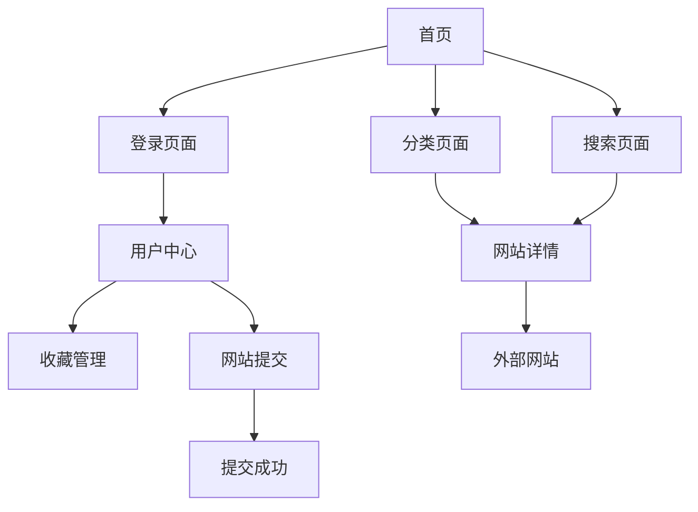

## 1. 产品概述

开发一个现代化的导航网站，类似于 `https://e.sap560.com/`，提供网站分类导航、搜索和用户管理功能。该网站旨在帮助用户快速找到所需的网站资源，支持多级分类、智能搜索和个性化收藏管理。

目标用户群体为需要高效获取网站资源的互联网用户，产品价值在于提供简洁、快速、智能的网站导航服务，提升用户的上网效率。

## 2. 核心功能

### 2.1 用户角色

| 角色 | 注册方式 | 核心权限 |
|------|----------|----------|
| 普通访客 | 无需注册 | 浏览网站、搜索网站、查看分类 |
| 注册用户 | 邮箱注册 | 收藏网站、管理常用网站、提交网站 |
| 管理员 | 后台创建 | 审核网站、管理分类、管理用户 |

### 2.2 功能模块

导航网站包含以下主要页面：
1. **首页**: 导航分类、热门网站、搜索功能、用户登录入口
2. **分类页面**: 多级分类导航、网站列表、筛选功能
3. **搜索页面**: 搜索结果、相关推荐、搜索历史
4. **用户中心**: 个人收藏、常用网站、提交历史、账户设置
5. **网站提交页面**: 网站信息填写、分类选择、提交审核
6. **网站详情页面**: 网站信息、访问统计、用户评价

### 2.3 页面详情

| 页面名称 | 模块名称 | 功能描述 |
|----------|----------|----------|
| 首页 | 导航分类 | 展示多级分类结构，支持展开收起，显示分类下的网站数量 |
| 首页 | 热门网站 | 展示访问量最高的网站，支持轮播展示 |
| 首页 | 搜索功能 | 提供关键词搜索框，支持模糊匹配和搜索建议 |
| 首页 | 用户登录 | 提供登录/注册入口，显示用户头像和昵称 |
| 分类页面 | 分类导航 | 面包屑导航显示当前分类路径 |
| 分类页面 | 网站列表 | 分页展示网站，支持按访问量、添加时间排序 |
| 搜索页面 | 搜索框 | 大字体搜索输入框，支持搜索历史和热门搜索 |
| 搜索页面 | 搜索结果 | 列表展示搜索结果，高亮匹配关键词 |
| 用户中心 | 我的收藏 | 管理用户收藏的网站，支持批量操作 |
| 用户中心 | 常用网站 | 根据访问频率自动排序的常用网站 |
| 用户中心 | 提交历史 | 查看用户提交的网站和审核状态 |
| 网站提交页面 | 信息填写 | 网站名称、URL、描述、分类选择 |
| 网站提交页面 | 提交审核 | 提交后进入待审核状态 |
| 网站详情页面 | 基本信息 | 网站标题、描述、截图、访问量 |
| 网站详情页面 | 访问入口 | 提供直达链接和安全跳转 |

## 3. 核心流程

### 普通用户流程
1. 访问首页 → 浏览分类或直接搜索 → 点击网站访问
2. 注册登录 → 收藏常用网站 → 管理个人收藏
3. 发现新网站 → 提交网站信息 → 等待审核

### 管理员流程
1. 登录管理后台 → 查看待审核网站 → 审核通过/拒绝
2. 管理分类 → 添加/修改/删除分类 → 调整分类结构
3. 数据统计 → 查看网站访问量 → 分析用户行为

## 4. 用户界面设计

### 4.1 设计风格
- **主色调**: 深蓝色 (#1e3a8a) 作为主色，白色背景，灰色辅助
- **按钮样式**: 圆角矩形设计，主要按钮使用渐变色
- **字体**: 中文使用思源黑体，英文使用 Inter，正文字号 16px
- **布局风格**: 卡片式布局，网格系统，顶部固定导航栏
- **图标风格**: 使用简洁的线性图标，统一线条粗细

### 4.2 页面设计概览

| 页面名称 | 模块名称 | UI元素 |
|----------|----------|--------|
| 首页 | 导航分类 | 左侧边栏设计，可折叠，图标+文字，悬停效果 |
| 首页 | 热门网站 | 网格卡片布局，每行4个，卡片包含图标、标题、描述 |
| 首页 | 搜索框 | 居中设计，宽度600px，圆角边框，搜索图标内嵌 |
| 分类页面 | 网站列表 | 列表式布局，每行显示网站图标、标题、描述、访问量 |
| 搜索页面 | 搜索结果 | 类似分类页面，增加关键词高亮显示 |
| 用户中心 | 收藏管理 | 网格布局，支持拖拽排序，批量删除按钮 |
| 网站提交 | 表单设计 | 分步骤表单，实时验证，友好的错误提示 |

### 4.3 响应式设计
- **桌面端优先**: 基础设计为1440px宽度，支持更大屏幕
- **平板适配**: 768px-1024px，调整为两列布局
- **移动端优化**: 小于768px，单列布局，触摸友好的大按钮
- **断点设置**: 480px、768px、1024px、1440px四个断点

### 4.4 性能优化要求
- **加载速度**: 首屏加载时间 < 2秒，Lighthouse评分 > 90
- **图片优化**: 使用 WebP 格式，懒加载，CDN 加速
- **代码分割**: 路由级别的代码分割，减少初始包体积
- **缓存策略**: 服务端渲染 + 客户端缓存，提升二次访问速度